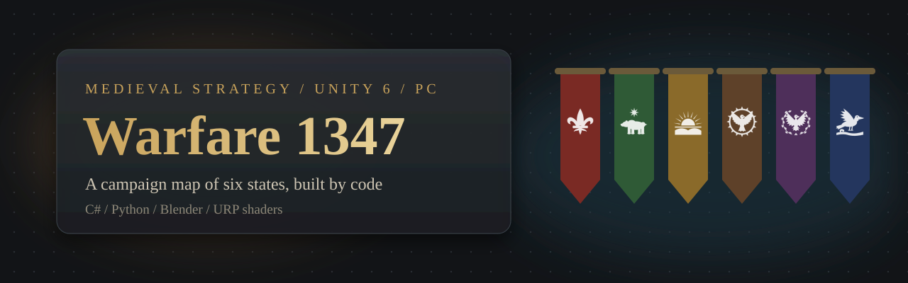

# Warfare 1347

> **Status: in development.** The world map, travel across it and the settlement
> screens work. Battles are at prototype stage, and there is no finished game
> loop yet. This is a learning and portfolio project, built step by step by a
> developer without a programming background, working together with an AI
> assistant.

A medieval strategy game for PC in the spirit of Mount & Blade: a 3D campaign
map of Eurasia with six states and 205 towns, castles and villages. The player's
party walks across the map by pathfinding that avoids water and mountains and
crosses rivers by bridges, with a game clock and x1 / x2 / x4 time speed.

The world is generated by code. Python scripts build the terrain, rivers, biomes
and roads from geographic data. All 77 settlement models are assembled in Blender
through Python, each state with its own architecture. Game rules live in a
separate C# core with no Unity dependency, and all game data is plain JSON.

Interface language: Russian.


## What is in it

**Campaign map.** Six states, each with 7 towns, 6 castles and 20 villages (the
Grimian Empire in the centre has 9 / 7 / 24). Settlements are placed to match each
state's lore and checked automatically for slopes, water, crowding and
reachability on foot.

**Settlements.** Houses from a free CC0 asset pack are re-coloured by script for
each culture: the same building becomes a Rus log house, a Norse house with a turf
roof or a Mediterranean house under red tiles. Every building is exported as its
own part, so the game hides the ones that would stand over water.

**Rivers through towns.** Where a river crosses a town's wall ring, the game cuts
the wall and builds a stone water gate on piers, raises stone quays along the
canal and places one bridge. Walls reach down to the ground and the water instead
of floating above a bank.

**Ground under settlements.** A per-settlement mask in the terrain shader paves
large towns with cobblestones and turns the ground of smaller settlements into
trodden, yellowed grass. Grass and trees do not grow there.

**Living map.** Procedural forests and rocks by biome, instanced meadow grass,
herds and wild animals, ships on sea routes, windmills and ruins, switchable
lighting presets, and faction banners over every settlement.

| | |
|---|---|
|  |  |
|  |  |

## Requirements

- Windows 11 (the only system it has been tried on).
- Unity **6000.6.4f1** with the Universal Render Pipeline.
- Git with **Git LFS**: models, textures and images are stored in LFS.

For the content tools only:

- Python 3.10 or newer with Pillow and NumPy (developed on 3.14).
- Blender 5.2 for the settlement and prop scripts.
- .NET SDK for running the core tests outside Unity.

## Run

```
git lfs install
git clone <this repository>
```

Open the folder in Unity Hub, open `Assets/Scenes/World.unity` and press Play.

### World map controls

| Key | Action |
|---|---|
| Left mouse button | walk the party, hold to keep walking |
| Space | wait |
| `+` / `-` | time speed x1 / x2 / x4 |
| `F` | camera to the party |
| `1` … `6` | camera to a state capital |
| Mouse wheel, `W A S D` | camera |

Developer keys: `F7` grass modes, `F8` light presets, `F9` light captures,
`F10` vegetation tour, `F11` settlement screenshots (list in
`Assets/StreamingAssets/Data/world/shots.json`).

## How the world is built

```
Tools/world/build_world.py          terrain, coastline, rivers, biomes, colour maps
Tools/world/check_settlements.py    slope, water and spacing check for a state, --fix moves settlements
Tools/world/build_roads.py          roads and bridges between settlements by pathfinding
Tools/blender/world_settlements_*   one script per state, builds and exports its settlement models
Tools/blender/world_pack_kit.py     imports pack buildings, re-colours them by role, simplifies them
Tools/showcase/build_instagram.py   the slides in docs/showcase/instagram
```

Runtime pieces in `Assets/Game/Client`: `WorldMap` (terrain, settlements, water
gates, quays, bridges), `WorldVegetation`, `WorldGrass`, `WorldCreatures`,
`WorldLandmarks`, `WorldParty`, `MapLighting`. Shaders are in `Assets/Resources`:
`WorldTerrain`, `GroundSurface.hlsl`, `WorldProp`, `Grass`, `GrassShell`.

## Project layout

```
Assets/Game/Core            game rules in plain C#, no UnityEngine (assembly Warfare.Core)
Assets/Game/Core.Tests      NUnit tests for the core, also runnable with dotnet test Tools/CoreTests
Assets/Game/Client          Unity side: map, camera, UI, rendering
Assets/StreamingAssets/Data game data in JSON: states, settlements, troops, goods, map settings
Assets/Art                  exported models and animations
Tools/                      Python and Blender tools that generate the world and the models
ArtSource/                  source material for the models
docs/                       plan, decisions, style references, showcase images
```

A new item, troop or settlement is added by editing JSON, without code.

## Known limitations

- **Battles are a prototype.** The campaign map is the finished part.
- **Russian interface only.** Strings are keyed for translation, other languages
  are not written yet.
- **Windows only, editor only.** No player build has been published.
- **Heavy repository.** Several hundred megabytes of models and textures in Git
  LFS; a clone downloads all of them.
- **No automated tests for the visual side.** The core has NUnit tests; the map
  and models were checked by eye with before and after screenshots.

## Credits and third-party assets

- [Quaternius](https://quaternius.com) asset packs (Medieval Village pack and
  MegaKit, Fantasy Props MegaKit), CC0.
- [Kenney](https://kenney.nl) sounds, CC0.
- [Poly Haven](https://polyhaven.com) textures, CC0.
- Blender Studio Human Base Meshes, CC0.
- Alegreya and Alegreya SC fonts by Huerta Tipográfica, SIL Open Font License 1.1.

## Not included in this repository

Some assets used during development are left out of this public copy, because
their licences either forbid redistributing the files or are not confirmed yet:

- character animations and the X Bot model from [Mixamo](https://www.mixamo.com);
- the tree and rock packs and the trees and rocks made from them;
- the animal pack and the map animals made from it;
- the boat pack and the map ships;
- the windmill and ruins models placed on the map.

The project opens without them, but the map has no forests, animals, ships or
landmarks, and characters have no animations. The list lives in
`docs/readme/public-exclude.txt`; `py Tools/publish/build_public.py` builds the
public branch from `main` without those files.

## License

The source code and the original content made for this project are released
under the [MIT License](LICENSE). Third-party assets listed above keep their own
licences.
